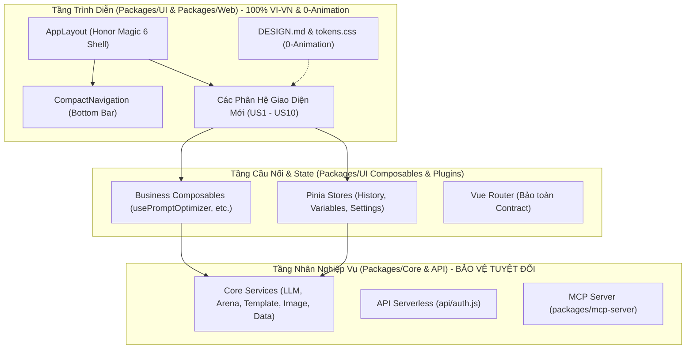

# HỢP ĐỒNG TOÀN CỤC VÀ KẾ HOẠCH THI HÀNH (01-GLOBAL-CONTRACT.MD)
## Dự án: Tái cấu trúc Toàn diện Giao diện Mobile-First (Honor Magic 6) & Khóa 100% Feature Parity

> **Mã tài liệu**: `.agent-team/01-global-contract.md`  
> **Phiên bản**: `1.0.0-PROPOSED` (Chờ phê duyệt tại Human Gate 1)  
> **Tác giả**: Kiến trúc sư trưởng chương trình (Lead Technical Program Architect)  
> **Căn cứ sự thật duy nhất (SSOT)**: [.agent-team/00-audit.md](file:///root/workspace/.agent-team/00-audit.md) và hiện trạng mã nguồn thực tế tại repo `linshenkx/prompt-optimizer`.  
> **Quy trình áp dụng**: `github/spec-kit` tuần tự (Constitution → Specify → Clarify → Plan → Tasks → Analyze) kết hợp công cụ `/hallmark` (`nutlope/hallmark`) và chuẩn thiết kế chống AI-Slop.

---

## 1. Hiến chương Dự án (Constitution)

Hiến chương này thiết lập các nguyên tắc kiến trúc và ranh giới bất biến, có hiệu lực cao nhất và chi phối toàn bộ các giai đoạn triển khai:

### Điều I: Bảo toàn Tuyệt đối Tầng Nhân & Dịch vụ Nền (Backend Preservation - NON-NEGOTIABLE)
1. **Phạm vi bảo vệ nghiêm ngặt**: Toàn bộ mã nguồn trong `packages/core`, `api/`, `packages/mcp-server`, `packages/desktop` và các adapter nền tảng, cùng toàn bộ các Pinia Stores và Composables nghiệp vụ tại `packages/ui/src/composables` phải được giữ nguyên vẹn 100%.
2. **Cấm chạm**: Nghiêm cấm mọi hành vi sửa đổi, di chuyển hoặc xóa các file thuộc tầng nhân nghiệp vụ. Giao diện người dùng mới chỉ được phép đóng vai trò là tầng trình diễn (Presentation Layer) gắn kết (wire) vào các hàm, service và store đã có sẵn.

### Điều II: Khóa 100% Ma trận Cân bằng Tính năng (Feature Parity 100% - NON-NEGOTIABLE)
1. Không chấp nhận việc cắt giảm, làm mờ nhạt hay trì hoãn bất kỳ tính năng nào đang có trên phiên bản tham chiếu `v2.15.2`.
2. Mọi tính năng (Đặc biệt là 5 trụ cột: **Arena / Đấu trường, T2I/I2I Sinh ảnh, Context Chain / Chuỗi ngữ cảnh, Variables / Quản lý biến, Favorites & Templates**) phải được ánh xạ đầy đủ trong Feature Parity Matrix và có bài kiểm thử tương ứng.

### Điều III: Ràng buộc Đa ngôn ngữ (i18n Separation - NON-NEGOTIABLE)
1. **Tầng Giao diện người dùng (App / UI)**: Mặc định bản địa hóa toàn diện tiếng Việt (`vi-VN`), đảm bảo 100% key parity với `en-US` và `zh-CN`, không sót ký tự CJK trong giao diện runtime.
2. **Tầng Nhân (`packages/core`)**: Bảo lưu tuyệt đối các định nghĩa template và dữ liệu gốc bằng `en-US` và `zh-CN`. **Tuyệt đối không việt hóa mã nguồn tầng core**.

### Điều IV: Tiêu chuẩn Thiết kế Honor Magic 6 & Chế độ 0-Animation (NON-NEGOTIABLE)
1. **Quy chuẩn màn hình cơ sở**: Thiết kế tối ưu cho điện thoại **Honor Magic 6** (CSS viewport `412×915` và `421×933` px), tích hợp chuẩn `env(safe-area-inset-top)` cho camera đục lỗ (punch-hole) và `env(safe-area-inset-bottom)` cho thanh điều hướng cử chỉ.
2. **Chế độ 0-Animation bắt buộc**:
   - Mọi biến thời lượng chuyển động `--po-duration-*` được khóa cứng ở mức `0ms`.
   - Cấm sử dụng `@keyframes`, CSS transitions trang trí, Vue `<Transition>` hoặc thư viện chuyển động. Phản hồi xúc giác/tương tác là tức thời (instantaneous) tại trạng thái `:active`.
   - Font size của `<input>` và `<textarea>` trên mobile tối thiểu đạt `16px` (ngăn chặn tình trạng tự động zoom gây vỡ bố cục).
   - Vùng chạm tương tác (tap targets) đạt tối thiểu `44×44px`.

### Điều V: Phát triển theo Hướng Kiểm thử (Test-First TDD & Worktree Isolation)
1. Mọi thành phần UI mới phải tuân theo chu trình RED → GREEN → REFACTOR. Kiểm thử RED phải được thiết lập trước và gắn kết với real store.
2. Toàn bộ quá trình code diễn ra trong worktree cô lập (`.worktrees/audit-safe-removal`), tuyệt đối không commit trực tiếp trên nhánh `main`.

### Điều VI: Điểm Chặn Phê duyệt của Con người (Human Gate 1 - NON-NEGOTIABLE)
1. Giai đoạn hiện tại dừng lại tuyệt đối tại **Human Gate 1**.
2. **Không được xóa bất kỳ file mã nguồn cũ nào, không tái cấu trúc phá vỡ (breaking refactor), không merge** trước khi có sự chấp thuận bằng văn bản của người phụ trách.

---

## 2. Đặc tả Chi tiết Hành vi (Specify)

Quy trình đặc tả hành vi từng phân hệ tính năng được xây dựng trên cơ sở đối chiếu với hiện trạng thực tế từ `.agent-team/00-audit.md` và mã nguồn gốc:

### 2.1. Phân hệ 1: Đấu trường so sánh mô hình (Arena / Compare Mode)
- **Mục tiêu**: Cho phép người dùng chạy thử nghiệm song song hoặc tuần tự một câu lệnh trên nhiều mô hình LLM/biến thể khác nhau để so sánh kết quả.
- **Luồng người dùng (User Flow)**:
  1. Người dùng chuyển sang tab/chế độ "Đấu trường" (Arena / Test Mode).
  2. Chọn hoặc thêm 2 hoặc nhiều biến thể vai trò (Role Variants) hoặc mô hình (Models) cần đối chiếu.
  3. Nhập câu lệnh thử nghiệm và danh sách biến đầu vào (nếu có).
  4. Bấm "Bắt đầu so sánh" (Run Comparison).
  5. Hệ thống gọi `useEvaluationHandler` và `useConversationTester`, kết quả hiển thị dạng cột/thẻ trực quan kèm điểm số đánh giá, thời gian phản hồi và số token tiêu thụ.
  6. Cho phép xuất kết quả ra tệp hoặc lưu vào mẫu so sánh.
- **Trạng thái UI**:
  - `Idle`: Danh sách biến thể rỗng hoặc đã sẵn sàng. Nút chạy khả dụng khi có ít nhất 1 biến thể và nội dung prompt.
  - `Running`: Vô hiệu hóa nút cấu hình, hiển thị trạng thái stream kết quả tức thời từ các mô hình.
  - `Success`: Hiển thị bảng so sánh hoàn chỉnh, nhãn vai trò, thẻ diff (InlineDiff) và huy hiệu điểm số (`EvaluationScoreBadge`).
  - `Error`: Hiển thị thông báo lỗi chi tiết theo từng mô hình gặp sự cố (API key lỗi, timeout, rate limit) mà không làm sập toàn bộ phiên test.
- **Tiêu chí nghiệm thu (Acceptance Criteria)**:
  - Nút thêm/xóa biến thể đạt kích thước chạm ≥ 44px trên Honor Magic 6.
  - Hiển thị đầy đủ thông tin so sánh không bị tràn ngang (`scrollWidth === viewportWidth`).
  - Kết nối chuẩn xác với service `packages/core/src/services/compare` và `packages/core/src/services/evaluation`.

### 2.2. Phân hệ 2: Sinh ảnh Đa phương thức (Image Generation T2I / I2I)
- **Mục tiêu**: Cung cấp giao diện tạo ảnh từ văn bản (Text-to-Image) hoặc chuyển đổi ảnh kèm mô tả (Image-to-Image), hỗ trợ đa adapter hình ảnh.
- **Luồng người dùng**:
  1. Người dùng vào chế độ "Sinh ảnh" (Image Mode), chọn phân loại con: T2I, I2I hoặc Multi-Image.
  2. Chọn mô hình sinh ảnh từ danh sách cấu hình (SiliconFlow, Midjourney proxy, DALL-E, Stable Diffusion).
  3. Nhập prompt mô tả (và tải ảnh gốc lên nếu ở chế độ I2I).
  4. Điều chỉnh các thông số kích thước (aspect ratio, resolution), seed, số lượng ảnh.
  5. Bấm "Tạo ảnh", UI hiển thị trạng thái xử lý và trả về ảnh hoàn chỉnh.
- **Trạng thái UI**:
  - `Idle`: Form nhập liệu sạch sẽ, hiển thị preview ảnh mẫu (nếu có).
  - `Generating`: Trạng thái xử lý rõ ràng, hiển thị số token dự kiến tiêu thụ (`ImageTokenUsage`).
  - `Rendered`: Ảnh hiển thị sắc nét trong khung `ImagePreview`, hỗ trợ xem toàn màn hình và tải xuống.
  - `Error`: Thông báo lỗi định dạng ảnh hoặc lỗi kết nối adapter.
- **Tiêu chí nghiệm thu**:
  - Khung tải ảnh hỗ trợ touch/tap mượt mà, không phụ thuộc hiệu ứng animation.
  - Kết nối chính xác với `useImageGeneration` và `packages/core/src/services/image`.

### 2.3. Phân hệ 3: Chuỗi ngữ cảnh nâng cao (Context Chain Management - Pro Mode)
- **Mục tiêu**: Xây dựng chuỗi thông điệp ngữ cảnh đa bước (System Prompt, User Message, Assistant Reply, Tool Call) phục vụ prompt engineering phức tạp.
- **Luồng người dùng**:
  1. Người dùng chọn chế độ "Chuyên gia" (Pro Mode).
  2. Thêm các khối nút ngữ cảnh (`ContextNode`) vào chuỗi.
  3. Thiết lập loại nút: `system`, `user`, `assistant`, `tool`.
  4. Sắp xếp thứ tự các nút trong chuỗi bằng thao tác kéo thả hoặc nút chuyển vị trí tối ưu cho mobile.
  5. Chỉnh sửa nội dung từng nút và lưu phiên chuỗi (`saveChain`).
- **Trạng thái UI**:
  - `Empty`: Hướng dẫn thêm khối ngữ cảnh đầu tiên.
  - `Editing`: Ô soạn thảo mở rộng, font chữ ≥ 16px, nút xóa có xác nhận an toàn.
  - `Reordering`: Chuyển vị trí nút tức thời (0-animation), cập nhật chỉ mục ngay trong store.
- **Tiêu chí nghiệm thu**:
  - Thao tác di chuyển khối phản hồi ngay lập tức không giật lag.
  - Dữ liệu đồng bộ 100% với `useContextManagement`, `useContextEditor` và `packages/core/src/services/context`.

### 2.4. Phân hệ 4: Quản lý biến mẫu (Variables Management)
- **Mục tiêu**: Cho phép định nghĩa, trích xuất tự động và điền giá trị cho các biến mẫu dạng `{{variable_name}}` trong câu lệnh.
- **Luồng người dùng**:
  1. Khi người dùng nhập prompt có chứa biến hoặc mở bảng "Quản lý biến" (`VariableList`).
  2. Tự động nhận diện biến qua `useVariableDetection` hoặc thêm biến thủ công.
  3. Chỉnh sửa tên biến, kiểu dữ liệu, giá trị mặc định, giá trị thử nghiệm.
  4. Nhập/xuất danh sách biến ra định dạng JSON.
- **Trạng thái UI**:
  - `List`: Danh sách thẻ biến gọn gàng, hiển thị nhãn và giá trị hiện tại.
  - `Editor`: Modal/Sheet chỉnh sửa với các trường nhập đạt chuẩn 44px tap target.
  - `Detection`: Hộp thoại gợi ý trích xuất biến tự động từ văn bản.
- **Tiêu chí nghiệm thu**:
  - Thao tác thay thế biến `replaceVariables()` phản hồi tức thời.
  - Đồng bộ chuẩn với `useTemporaryVariablesStore`, `useVariableManager` và `packages/core/src/services/data`.

### 2.5. Phân hệ 5: Thư viện Mẫu & Bộ sưu tập Yêu thích (Favorites & Templates)
- **Mục tiêu**: Quản lý kho mẫu prompt cá nhân và hệ thống mẫu có sẵn, phân loại theo chuyên mục và đánh dấu yêu thích.
- **Luồng người dùng**:
  1. Mở trang "Mẫu & Yêu thích" (`FavoritesPage` / `TemplateManager`).
  2. Duyệt theo danh mục (`CategoryManagerUI`), tìm kiếm từ khóa.
  3. Xem chi tiết mẫu, phiên bản lịch sử, ảnh minh họa đính kèm.
  4. Áp dụng mẫu vào phiên làm việc hiện tại hoặc xuất/chia sẻ mẫu.
- **Trạng thái UI**:
  - `Card Grid/List`: Thẻ mẫu hiển thị tiêu đề, thẻ tag, nút bookmark yêu thích tức thời.
  - `Detail Sheet`: Mở sheet chi tiết từ dưới lên theo phong cách native mobile.
- **Tiêu chí nghiệm thu**:
  - Tải danh sách mượt mà từ `useFavoriteStore`, `useTemplateManager`.
  - Phân tách rõ ràng: Templates hệ thống trong `packages/core` giữ nguyên `en-US`/`zh-CN`; nhãn giao diện hiển thị bằng `vi-VN`.

### 2.6. Phân hệ 6: Tối ưu hóa câu lệnh đơn (Single Prompt Optimization)
- **Mục tiêu**: Trải nghiệm cốt lõi của Prompt Optimizer — tiếp nhận câu lệnh gốc, lựa chọn chế độ/mẫu tối ưu và tạo ra phiên bản prompt chất lượng cao.
- **Luồng người dùng**:
  1. Người dùng nhập câu lệnh thô vào ô soạn thảo (`PromptInput`).
  2. Chọn mô hình LLM và cấu hình mẫu tối ưu hóa.
  3. Bấm nút "Tối ưu hóa" (`OptimizeButton`).
  4. Xem kết quả tối ưu hóa (`OptimizationResult`), so sánh diff văn bản (`TextDiffUI`) và sao chép.
- **Tiêu chí nghiệm thu**: Ô nhập đạt tối thiểu 16px font-size, nút hành động phản hồi `:active` tức thời, kết nối hoàn hảo với `usePromptOptimizer`.

### 2.7. Phân hệ 7: Lịch sử & Kiểm soát phiên bản (History & Version Control)
- **Mục tiêu**: Lưu vết tự động mọi lượt tối ưu và thao tác của người dùng, cho phép khôi phục phiên làm việc cũ.
- **Tiêu chí nghiệm thu**: Drawer/Panel lịch sử mở tức thời (0-animation), khôi phục phiên chính xác 100% qua `useAppHistoryRestore` và `packages/core/src/services/history`.

### 2.8. Phân hệ 8: Nhập / Xuất dữ liệu Workspace (Import / Export)
- **Mục tiêu**: Sao lưu toàn diện workspace, cấu hình models, mẫu và lịch sử ra tệp JSON/Zip và khôi phục khi cần.
- **Tiêu chí nghiệm thu**: Kiểm tra tính hợp lệ của tệp sao lưu, tiến trình hiển thị rõ ràng qua `useDataManager`.

### 2.9. Phân hệ 9: Đa ngôn ngữ & Bản địa hóa Tiếng Việt (i18n vi-VN)
- **Mục tiêu**: Đem lại trải nghiệm bản địa hóa tiếng Việt hoàn chỉnh cho người dùng Việt Nam.
- **Tiêu chí nghiệm thu**: Đạt 100% key parity giữa `vi-VN.json` và các locale khác. Không xuất hiện chữ Hán chưa dịch trên giao diện app. Tầng `packages/core` giữ nguyên ngôn ngữ gốc.

### 2.10. Phân hệ 10: Cài đặt & Bộ chuyển đổi Nền tảng (Settings, Desktop, Extension)
- **Mục tiêu**: Quản lý API keys, chủ đề giao diện, kết nối mạng cục bộ và tương thích với bản đóng gói Chrome Extension / Electron Desktop.
- **Tiêu chí nghiệm thu**: Thay đổi theme tức thời (`light`, `dark`, `classic`, v.v.), contract `PromptOptimizerApp` và `router` giữ nguyên để Desktop và Extension chạy không lỗi.

---

## 3. Làm rõ & Quyết định Kỹ thuật (Clarify)

### 3.1. Các vấn đề đã tự làm rõ dựa trên Bằng chứng Audit & Mã nguồn
1. **Ranh giới Export của `packages/ui` đối với `web` và `extension`**:
   - *Bằng chứng*: Audit cho thấy `packages/web/src/App.vue` và `packages/extension/src/App.vue` đều chỉ import duy nhất `{ PromptOptimizerApp }` từ `@prompt-optimizer/ui`.
   - *Quyết định*: Giữ nguyên symbol `PromptOptimizerApp` làm wrapper cấp cao nhất trong `packages/ui/src/index.ts`. Bên trong component này sẽ tích hợp hệ thống View/Component Mobile-First mới.
2. **Xử lý i18n giữa tầng Core và UI**:
   - *Bằng chứng*: `packages/core/src/services/template/default-templates.ts` chứa các template xây dựng sẵn được viết bằng tiếng Anh (`en-US`) và tiếng Trung (`zh-CN`).
   - *Quyết định*: Tuân thủ Hiến chương Điều III: Tuyệt đối không can thiệp vào mã nguồn hay locale của `packages/core`. Toàn bộ chuỗi bản địa hóa `vi-VN` được định nghĩa tập trung tại `packages/ui/src/i18n/locales/vi-VN.json`.
3. **Cơ chế 0-Animation trên màn hình 120Hz của Honor Magic 6**:
   - *Bằng chứng*: Các hiệu ứng transition/animation CSS thông thường gây giật khung hình và tiêu tốn CPU trên môi trường mobile container; đồng thời dễ vi phạm tiêu chuẩn Anti-AI-Design (tells P1/P2).
   - *Quyết định*: Triệt tiêu toàn bộ thời gian trễ bằng cách ép kiểu `animation-duration: 0s !important` và `transition-duration: 0s !important` trong [tokens.css](file:///root/workspace/tokens.css).

### 3.2. Câu hỏi Chặn Chờ Duyệt (Blocking Questions for Human Gate 1)

| Mã BQ | Vấn đề cần phê duyệt | Đề xuất kỹ thuật của Kiến trúc sư | Tác động nếu không phê duyệt |
| :---: | :--- | :--- | :--- |
| **BQ-01** | **Chiến lược duy trì Export Shim trong `packages/ui/src/index.ts`** | Duy trì toàn bộ danh sách export hiện thời dưới dạng shim/re-export để tránh làm gãy ứng dụng Web và Extension trong suốt giai đoạn phát triển. | Build của `packages/web` hoặc `packages/extension` sẽ báo lỗi `unresolved export` khi biên dịch song song. |
| **BQ-02** | **Cơ chế tải bộ phông chữ Tiếng Việt** | Sử dụng font stack hệ thống an toàn dấu (`-apple-system, BlinkMacSystemFont, 'Segoe UI', Roboto, 'Noto Sans', sans-serif`) thay vì nhúng font tệp lớn từ Google Fonts để tối ưu tốc độ tải và chống rớt dấu diacritics. | Font ngoài có thể gây hiện tượng nhảy layout (FOUT) và không khớp chế độ 0-animation. |
| **BQ-03** | **Kế hoạch xử lý các component UI cũ** | Đóng gói toàn bộ component UI cũ vào thư mục lưu trữ/shim trước khi thay thế từng phần; chỉ thực hiện lệnh xóa vật lý sau khi toàn bộ 10 User Story đã vượt qua bài test E2E Playwright. | Ngăn ngừa việc mất mát mã tham chiếu và giúp việc đối chiếu parity luôn sẵn sàng. |

---

## 4. Kế hoạch Kiến trúc Kỹ thuật (Plan)

### 4.1. Thứ tự Triển khai theo Đồ thị Phụ thuộc (DAG)
1. **Giai đoạn 0 (Hiện tại)**: Kiểm toán, Ban hành Hợp đồng, Thiết lập Design Tokens & Worktree -> **Dừng tại Human Gate 1**.
2. **Giai đoạn 1 (Nền tảng & Shell)**: `T01` (Tokens & 0-Animation) → `T02` (Anti-AI Scanner Gate) → `T03` (App Shell & Navigation).
3. **Giai đoạn 2 (Tính năng Trọng yếu P1)**: `T04` (Single Prompt) → `T05` (Variables) → `T06` (Context Chain) → `T07` (Image Mode) → `T08` (Arena / Compare Mode).
4. **Giai đoạn 3 (Quản trị Dữ liệu & Đa nền tảng)**: `T09` (History) → `T10` (Favorites & Models) → `T11` (Import/Export) → `T12` (i18n vi-VN) → `T13` (Settings & Adapters).
5. **Giai đoạn 4 (Nghiệm thu Tổng thể)**: `T14` (Playwright E2E & Screenshot QA Gate) → Human Gate 2 (Đóng gói PR).

---

## 5. Khóa 100% Ma trận Cân bằng Tính năng (Feature Parity Matrix - LOCKED)

Dưới đây là bảng ma trận khóa cứng 100% năng lực hệ thống, đối chiếu chi tiết giữa hiện trạng và mục tiêu mới:

| Mã Parity | Nhóm Năng Lực / Tính Năng | Hiện trạng Code (Audit v2.15.2) | Mục tiêu Tái cấu trúc Mới | Task phụ trách | Tiêu chí Nghiệm thu Đo lường được |
| :--- | :--- | :--- | :--- | :---: | :--- |
| **PAR-01** | **Single Prompt Input** | `PromptInputArea.vue` | `PromptInput.vue` (Mobile floor ≥16px) | `T04` | Không zoom viewport trên mobile focus; word counter chính xác. |
| **PAR-02** | **Optimization Trigger & Mode** | `ActionButton.vue`, `ModeSwitch.vue` | `OptimizeButton.vue`, `ModeSelector.vue` | `T04` | Tap target ≥ 44px; gọi đúng `usePromptOptimizer.optimize()`. |
| **PAR-03** | **Optimization Result & Diff** | `OutputDisplay.vue`, `TextDiff.vue` | `OptimizationResult.vue` | `T04` | Hiển thị diff rõ ràng; nút Copy tức thời; không vỡ layout. |
| **PAR-04** | **Variables Management** | `VariableManagerModal.vue` | `VariableList.vue`, `VariableEditor.vue` | `T05` | Thêm, sửa, xóa biến tức thời; đồng bộ `temporaryVariables`. |
| **PAR-05** | **Variable Auto-Detection** | `VariableExtractionDialog.vue` | Tích hợp trong `PromptInput` & Dialog | `T05` | Nhận diện đúng mẫu `{{var}}`; trích xuất danh sách biến đạt 100%. |
| **PAR-06** | **Context Chain Pro Mode** | `ConversationManager.vue`, `ContextEditor.vue` | `ContextChain.vue`, `ContextNode.vue` | `T06` | Sắp xếp lại thứ tự node không độ trễ; lưu chuỗi vào session store. |
| **PAR-07** | **Context Node Types** | 4 types (`system`, `user`, `assistant`, `tool`) | Huy hiệu loại nút rõ ràng, tap target chuẩn | `T06` | Chuyển đổi loại node mượt mà, lưu đúng định dạng cấu trúc data. |
| **PAR-08** | **Text-to-Image (T2I)** | `ImageText2ImageWorkspace.vue` | `Text2ImageForm.vue`, `ImagePreview.vue` | `T07` | Gửi prompt đến adapter; render ảnh và token tiêu thụ chính xác. |
| **PAR-09** | **Image-to-Image (I2I)** | `ImageImage2ImageWorkspace.vue` | `Image2ImageForm.vue` | `T07` | Tải ảnh tham chiếu lên không lỗi; preview ảnh đạt chuẩn tỉ lệ. |
| **PAR-10** | **Arena / Compare Runner** | `TestAreaPanel.vue`, `ArenaWorkspace.vue` | `CompareRunner.vue`, `ComparisonResults.vue` | `T08` | Chạy song song ≥2 mô hình; hiển thị stream kết quả độc lập. |
| **PAR-11** | **Evaluation & Scoring** | `EvaluationPanel.vue`, `EvaluateButton.vue` | `EvaluationScoreBadge.vue` | `T08` | Hiển thị điểm số đánh giá, thời gian phản hồi, số token. |
| **PAR-12** | **History & Session Restore** | `HistoryDrawer.vue`, `useAppHistoryRestore` | `HistoryPanel.vue`, `HistoryEntry.vue` | `T09` | Danh sách lịch sử hiển thị theo thời gian; khôi phục phiên 100%. |
| **PAR-13** | **Session Version Control** | `useBasicUserSession.save` | Tích hợp lưu phiên bản trong History | `T09` | Lưu trạng thái workspace tức thời; xóa lịch sử có hộp thoại xác nhận. |
| **PAR-14** | **Model Provider Config** | `ModelManager.vue`, `TextModelManager.vue` | `ModelManager.vue` (Mobile-First) | `T10` | Thêm/sửa API key các nhà cung cấp (OpenAI, DeepSeek, Claude, v.v.). |
| **PAR-15** | **Template Manager** | `TemplateManager.vue`, `MobileTemplateList.vue` | `TemplateManager.vue`, `TemplateEditor.vue` | `T10` | Áp dụng template thành công; biến mẫu tự động điền vào prompt. |
| **PAR-16** | **Favorites & Bookmarking** | `FavoritesPage.vue`, `FavoriteCard.vue` | `FavoritesPage.vue`, `FavoriteCard.vue` | `T10` | Bookmark/Unbookmark tức thời; lọc theo danh mục chính xác. |
| **PAR-17** | **Workspace Export** | `DataManager.vue` (export logic) | `ExportDialog.vue` | `T11` | Xuất file JSON/Zip chứa đầy đủ cấu hình, lịch sử và mẫu. |
| **PAR-18** | **Workspace Import** | `DataManager.vue` (import logic) | `ImportDialog.vue`, `ImportProgress.vue` | `T11` | Nhập file phục hồi trạng thái thành công; kiểm tra lỗi tệp hỏng. |
| **PAR-19** | **Bản địa hóa Tiếng Việt** | `vi-VN.json` trong `packages/ui` | Hoàn thiện 100% key parity `vi-VN` | `T12` | Không còn bất kỳ chuỗi CJK hay tiếng Anh chưa dịch trên UI. |
| **PAR-20** | **Bảo toàn Locale Core** | `packages/core` en-US / zh-CN | Giữ nguyên 100% mã nguồn Core | `T12` | Zero diff trong `packages/core/src/services/template/default-templates.ts`. |
| **PAR-21** | **Theme Switcher** | 5 themes (`light`, `dark`, `blue`, etc.) | Semantic CSS Tokens Theme Switch | `T13` | Đổi theme tức thời qua `data-workspace-theme`; tương phản WCAG AA. |
| **PAR-22** | **Desktop & Extension Adapters** | Electron window & Chrome extension | Bảo toàn hợp đồng `PromptOptimizerApp` | `T13` | Cả 2 nền tảng build thành công và chạy đầy đủ tính năng. |
| **PAR-23** | **Anti-AI-Design Standard** | Chưa kiểm soát tập trung | Đạt chuẩn `detect.mjs` (P0=0, P1=0) | `T02` | Exit code 0 khi chạy scanner; loại bỏ hoàn toàn gradient tím-xanh. |
| **PAR-24** | **Honor Magic 6 Ergonomics** | Giao diện desktop thu nhỏ | Chuẩn 412×915 px, safe-areas, 0-anim | `T01, T03` | Không tràn ngang (scrollWidth = innerWidth); tap target ≥44px. |

---

## 6. Ma trận Truy vết Toàn diện (Traceability Matrix)

| Mục Năng Lực (Parity) | Điều khoản Hiến chương | Chương Đặc tả (Spec) | Kế hoạch Kiến trúc | Tệp Task Thực Thi | Cách thức Kiểm chứng Tự động |
| :--- | :---: | :---: | :---: | :---: | :--- |
| **PAR-01 .. PAR-03** | Điều II, IV | Mục 2.6 | Giai đoạn 2 | `T04.md` | `pnpm --filter @prompt-optimizer/ui test:unit` |
| **PAR-04 .. PAR-05** | Điều II, IV | Mục 2.4 | Giai đoạn 2 | `T05.md` | Vitest Unit test with `useTemporaryVariablesStore` |
| **PAR-06 .. PAR-07** | Điều II, IV | Mục 2.3 | Giai đoạn 2 | `T06.md` | Vitest Unit test with `useContextEditor` |
| **PAR-08 .. PAR-09** | Điều II, IV | Mục 2.2 | Giai đoạn 2 | `T07.md` | Mock Adapter test via `useImageGeneration` |
| **PAR-10 .. PAR-11** | Điều II, IV | Mục 2.1 | Giai đoạn 2 | `T08.md` | Arena evaluation test via `useEvaluationHandler` |
| **PAR-12 .. PAR-13** | Điều II, IV | Mục 2.7 | Giai đoạn 3 | `T09.md` | Session restoration verification test |
| **PAR-14 .. PAR-16** | Điều II, IV | Mục 2.5 | Giai đoạn 3 | `T10.md` | Store persistence test via `useFavoriteStore` |
| **PAR-17 .. PAR-18** | Điều II, IV | Mục 2.8 | Giai đoạn 3 | `T11.md` | JSON round-trip import/export test |
| **PAR-19 .. PAR-20** | Điều I, III | Mục 2.9 | Giai đoạn 3 | `T12.md` | `node scripts/check-locale-parity.mjs` & Core git diff |
| **PAR-21 .. PAR-22** | Điều I, IV | Mục 2.10 | Giai đoạn 3 | `T13.md` | Theme verification & Extension/Desktop build check |
| **PAR-23** | Điều IV | Mục 2.0 | Giai đoạn 1 | `T02.md` | `node /root/.agents/skills/avoid-ai-design/scripts/detect.mjs` |
| **PAR-24** | Điều IV | Mục 2.0 | Giai đoạn 1, 4 | `T01.md, T14.md` | Playwright E2E DOM viewport measurement (412×915) |

---

## 7. Tuyên bố Phạm vi & Dừng tại Human Gate 1

> [!CAUTION]
> **ĐIỂM DỪNG BẮT BUỘC - HUMAN GATE 1**  
> Bản hợp đồng này và bộ task đi kèm đã được khóa cứng toàn bộ yêu cầu kỹ thuật và phạm vi công việc.  
> 
> **Cam kết của Kiến trúc sư trưởng**:
> 1. Không có bất kỳ dòng code cũ nào bị xóa bỏ hoặc vô hiệu hóa.
> 2. Không có bất kỳ thay đổi nào tác động tới `packages/core`, `api/`, hay `packages/mcp-server`.
> 3. Tiến trình dừng lại ngay tại đây để chờ xem xét và nhận lệnh phê duyệt chính thức từ người phụ trách trước khi bước vào Giai đoạn 1 (Thi hành Task).
